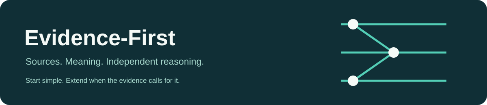

# Evidence-First



[한국어](README.md) · English · [日本語](README.ja.md) · [中文](README.zh.md)

**Check evidence, separate interpretation, and act within authority.**
Start with behavioral guidance. Add a Wiki, SQLite, graph DB, or RAG when useful.

`0.1.1 preview` · local helpers · multilingual · not listed in official directories

### Quick install

Codex CLI:

```sh
codex plugin marketplace add o-min222/enterprise-ontology-architecture
codex plugin add evidence-first@evidence-first-plugins
```

Inside Claude Code:

```text
/plugin marketplace add o-min222/enterprise-ontology-architecture
/plugin install evidence-first@evidence-first-plugins
```

Start a new conversation: “Set up Evidence-First for this project. Use English and start with behavior only.” Invoke `$evidence-first-setup` in Codex or `/evidence-first:evidence-first-setup` in Claude Code. Ordinary tasks can use the core without setup.

Other skill hosts can use the complete `skills/evidence-first` folder. See the [plugin guide](docs/plugin-guide.md) for activation, project instructions, updates, removal, and compatibility limits. Installation does not automatically copy AGENTS.md or CLAUDE.md into target projects.

| Need | Included |
| --- | --- |
| Evidence-led analysis and coding | Core guidance, independent 5×4 classification, proportionate verification |
| Durable project knowledge | Optional Wiki, SQLite, real local RDF graph DB |
| Cited retrieval | Local BM25 context; the calling AI generates the answer |
| Better working methods | Observed friction, concrete proposal, authorized execution, outcome review |
| Language choice | English/Korean full guides; Japanese/Chinese quickstarts/catalogs; other-language answers with explicit catalog fallback |

[Examples](skills/evidence-first/examples/README.en.md) · [Installation](docs/evidence-first-installation.en.md) · [Changelog](CHANGELOG.md) · [Contributing](CONTRIBUTING.md) · [Support/license status](SUPPORT.md) · [Privacy](PRIVACY.md) · [Security](SECURITY.md)

Distributed under the [MIT License](LICENSE). Preserve the copyright and permission notice when using, modifying, or redistributing copies. Plugin instructions do not expand the AI host's actual permissions.

---

## Enterprise ontology architecture background

[한국어](README.md) · English · [日本語](README.ja.md) · [中文](README.zh.md)

Shared L1 source records and L2 semantic definitions, independent interpretations, proportionate verification, provenance, and separate execution authority. AI is an external L3 consumer; the ontology does not require AI.

## Use the skill

- [Standard SKILL.md](skills/evidence-first/SKILL.md): one portable evidence-first skill; answer in the user's language.
- [Install and connect](docs/evidence-first-installation.en.md): Codex/Claude Code paths, AGENTS.md/CLAUDE.md integration, pinned versions, updates.
- [Multilingual support](skills/evidence-first/references/languages.md): message catalogs, language fallback, translation boundaries, cross-language retrieval.
- [English synthetic examples](skills/evidence-first/examples/README.en.md) and [tests](tests/README.en.md).

Copy the entire skills/evidence-first folder, not just SKILL.md. The skill does not grant data access or enforce security. Do not publish private data or credentials.

## Choose independently, extend later

Storage: none, file Wiki, SQLite, Oxigraph RDF graph DB, or combinations. Features: basic lookup, graph relationship lookup, RAG. Select one primary store. RAG works over Wiki/SQLite/graph and is not a storage type or maturity stage.

[Setup and migration](skills/evidence-first/references/workspace-lifecycle.en.md) support read-only plans, complete-record comparison, primary switching, and retained originals. [Graph/RAG](skills/evidence-first/references/graph-and-rag.en.md) provide a real local RDF DB and lexical search/cited context for the calling AI's generation. Remote DB adapters, vector embeddings, model APIs, synchronization, and scheduling are separate implementation scope.

All five information types—observation, hypothesis, reviewed_assessment, official_decision, execution_result—allow all four statuses—unverified, in_review, verified, disputed. Checking decision existence does not prove correctness or grant execution rights.

## Initiative and efficiency

[Adaptation](skills/evidence-first/references/adaptive-environment.en.md): observe actual need, compare alternatives, propose a concrete change, execute inside existing authority, then verify outcomes. Default task_scoped uses current task permission. Optional propose_only/scoped_auto preferences remain separate from real access controls.

[Efficient work](skills/evidence-first/references/efficient-work.en.md): preserve quality/provenance/permission while comparing total setup, execution, review, and maintenance burden. Start small, keep the current method when sufficient, and reuse conditional local experience without treating it as universal truth or model training.

## Languages

English and Korean core operating guides are authored in this repository. Japanese and Simplified Chinese have quickstarts and tool catalogs. The AI may explain and answer in another requested language using a maintained guide, while clearly distinguishing source text, translation, and unsupported/reviewed localization. Tool labels and RAG generation rules support en/ko/ja/zh; technical CLI diagnostics remain English. Valid unsupported tags use an explicit English-message fallback.

Use --lang before the command. It changes presentation, not records, IDs, permissions, or primary storage:

```sh
python "PATH_TO_SKILL/scripts/workspace.py" --root "PROJECT" --lang en init --mode wiki
python "PATH_TO_SKILL/scripts/rag.py" --root "PROJECT" --lang ja retrieve --question "冷却原因は確認されましたか？" --search-query "cooling cause"
```

Local retrieval is lexical. Source-language keywords may be prepared by the calling AI; the helper retains the original question and reports rewrites. A new index format adds basic CJK bigrams; rebuild older indexes. No automatic external translation is performed.

## Architecture and existing prompts

The original Korean architecture docs and prompts remain intact. The [English architecture overview](docs/architecture.en.md) describes L1/L2/L3, governance, incremental implementation, and claim limits. [English implementation prompts](prompts/README.en.md) support Wiki, PostgreSQL design, and validation. The project is platform-independent guidance, not a replacement enterprise data platform.
